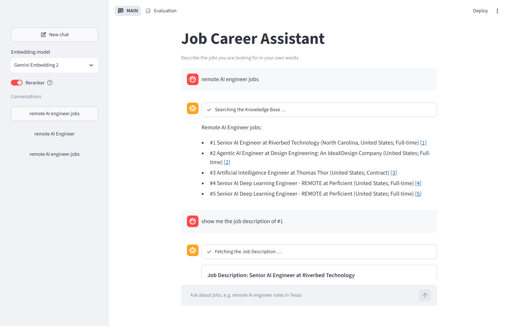
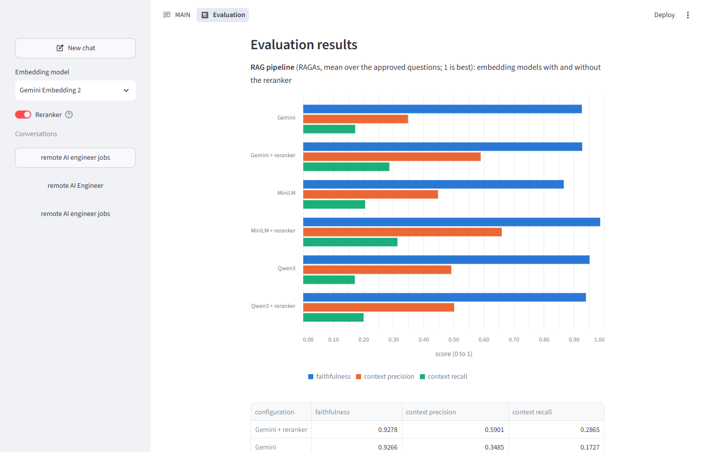
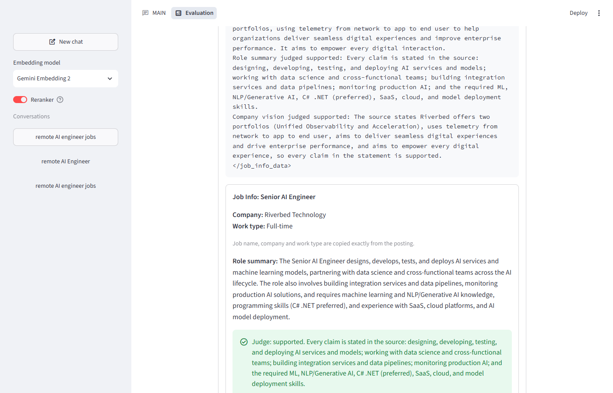
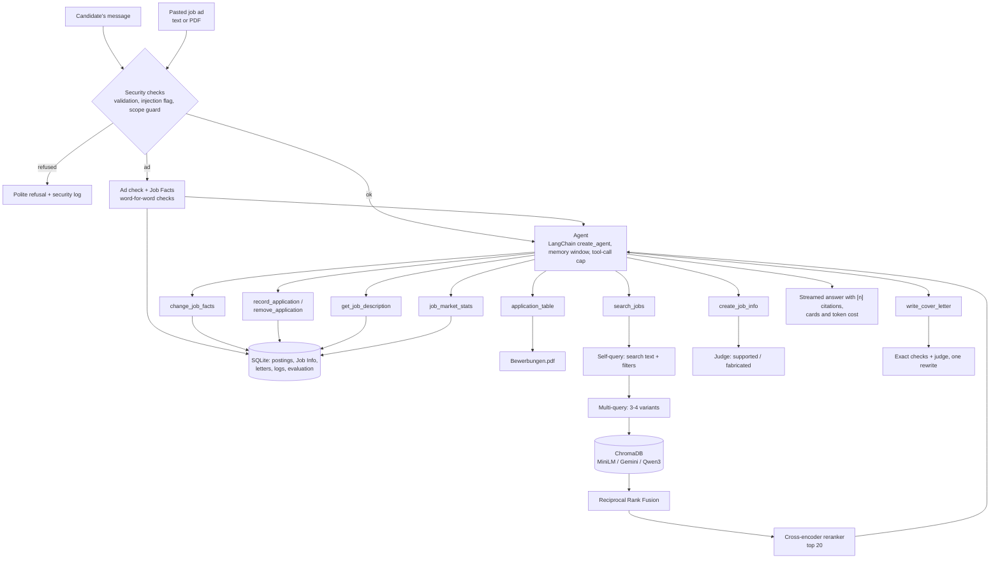

# Job Career Assistant

A chatbot for my own job search. It finds job postings that match my Target Roles, explains a
chosen job, and writes a personalised cover letter for it, without inventing facts about me or
the employer. Since v2 it also works on the real German job ads I apply to: I paste an ad (or
attach its PDF), get its Job Facts and a German or English Cover Letter, record my Applications,
and download them as one German table, `Bewerbungen.pdf`, for my Berater at the Arbeitsagentur.
Built for the Turing College Sprint 2 project (LangChain, advanced RAG, tool calling,
Streamlit).

The app has two pages: **MAIN**, the chat, and **Evaluation**, everything behind the answers.

> **Status: v2.0, complete.** v1: search, Job Info, Cover Letters, job market statistics,
> memory, security measures, an Evaluation tab and a measured RAGAs evaluation. v2: pasted
> Job Postings (text or PDF), Job Facts, German Cover Letters, Applications and the Application
> Table (see [v2: pasted Job Postings and Applications](#v2-pasted-job-postings-and-applications)).



|  |  |
| --- | --- |

## Course requirements

| Requirement | Where |
| --- | --- |
| Advanced RAG: query translation | Self-query (search text + metadata filters) and multi-query (3-4 variants), `rag/retriever.py` |
| Advanced RAG: structured retrieval | Metadata filters (remote, location, work type, experience, Target Role) on ChromaDB; Reciprocal Rank Fusion; cross-encoder reranker |
| At least 3 domain tools | 9 tools: v1's `search_jobs`, `get_job_description`, `create_job_info`, `write_cover_letter`, `job_market_stats`; v2's `change_job_facts`, `record_application`, `remove_application`, `application_table` (`tools/`) |
| LangChain with OpenRouter | `create_agent` with OpenRouter models through LangChain's OpenAI-compatible client (`llm.py`, `agent/`) |
| Streamlit UI with sources, tool results, progress | MAIN page: streamed answers, status lines while tools run, linked `[n]` citations, cards per tool |
| Security measures | Input validation, prompt-injection flagging, LLM scope guard, tool-call cap, personal-data redaction, security log (`security.py`) |
| Optional: conversation history and export | Sidebar Conversations; Evaluation tab exports Markdown and JSON |
| Optional: RAG visualisation, citations | Evaluation tab: filters, query variants, per-query results, fusion and reranker scores, matched chunks |
| Optional: token and cost display | Under each answer, and per answer and in total on the Evaluation tab |
| Optional: tool-result visualisation | Each tool call with arguments, result and its card (Job Info, letter, chart) |
| Optional: RAGAs evaluation with reranking | `turing-projects-v2 evaluate`, results with charts on the Evaluation tab (see [Evaluation](#evaluation)) |

## Install

Requires [uv](https://docs.astral.sh/uv/) and Python 3.14.

```bash
uv sync
```

## Configure

1. Copy `.env.example` to `.env` and set `OPENROUTER_API_KEY`. `.env` is git-ignored; the app
   refuses to start without the key. Optional settings (agent and judge model, default
   embedding model, tool-call cap, history window) are listed in `.env.example`.
2. Put your own details in `candidate/profile.toml` (it ships with made-up example details), or
   keep your real profile outside the repo and set `CANDIDATE_DIR` in `.env` to that folder
   (it needs `profile.toml` and `templates/`), so personal details never reach git. The
   Candidate Profile is the only source of facts about the candidate; its `[target_roles]` table
   maps each Target Role to an English and a German Letter Template in
   `candidate/templates/<name>.txt` (gaps marked as `{{gap_name}}`), e.g.
   `"AI Engineer" = { English = "ai", German = "ai_de" }`. A pasted German ad gets the German
   template (the assistant never translates one); Kaggle postings always get the English one.
3. `candidate/title_variants.toml` lists, per Target Role, the job-title phrases to include and
   exclude.

## Data

Download the Kaggle dataset [LinkedIn Job Postings (2023-2024)](https://www.kaggle.com/datasets/arshkon/linkedin-job-postings)
and unpack it so these files exist (the `data/` folder is git-ignored):

```
data/raw/linkedin/postings.csv
data/raw/linkedin/companies/companies.csv
```

## Run

Times are what I measured on my machine with the default models; costs are approximate.

```bash
uv run turing-projects-v2                    # check settings and the Candidate Profile
uv run turing-projects-v2 import-data        # import all postings + companies, then tag (~1 min, free)
uv run turing-projects-v2 tag                # re-tag after editing title_variants.toml (~10 s, free)
uv run turing-projects-v2 review-titles      # list the titles tagged per Target Role
uv run turing-projects-v2 index              # embed tagged postings with all 3 models (~15-40 min, ~$0.35 once)
uv run turing-projects-v2 search "remote AI engineer jobs"   # search the way the chatbot does
                                                              # (--model minilm|gemini|qwen3)
uv run turing-projects-v2 chat               # open the chatbot in the browser
```

- One chat answer costs well under 1 cent; the cost is shown under each answer.
- The first page load takes up to a minute while the Knowledge Base and the reranker load.
- `import-data` and `index` are safe to re-run: postings are updated by ID, and only postings
  not yet in the Knowledge Base are embedded.

Evaluation (see [Evaluation](#evaluation)):

```bash
uv run turing-projects-v2 evaluate generate  # RAGAs test-set questions from tagged postings (~5 min)
uv run turing-projects-v2 evaluate agent     # 10 hand-written tool-calling cases (~1 min, cents)
uv run turing-projects-v2 evaluate fields    # field accuracy over saved Cover Letters (free)
uv run turing-projects-v2 evaluate rag       # 6 configurations x approved questions (~15 min, ~$0.70)
                                             # (--workers N: questions at a time, default 4; I used 8)
```

Generated questions are approved or rejected on the Evaluation tab before `evaluate rag`.

## v2: pasted Job Postings and Applications

v1 only knows the Kaggle postings: old US jobs. v2 lets me work on the jobs I actually apply to,
mostly German ads on company and university websites, and gives my Berater at the Arbeitsagentur
the list of Applications they ask for. The Kaggle search and everything else from v1 stay as they
are.

**Paste a job ad.** On the MAIN page, open **Paste a job ad**, paste the full text of the ad and
press **Send the job ad**; or attach the ad as a PDF with the paperclip in the chat input (a
typed message alongside it is optional). The ad becomes a pasted Job Posting with its own job ID,
stored unchanged; pasting the same ad again reuses it. An ad may have up to 30,000 characters,
while typed messages keep v1's 2,000-character limit. The ad goes through the same
prompt-injection check (flagged and logged) and reaches the model only as data. A PDF without
readable text (a scan) is refused with a request to paste the text, and a text that is not a job
ad is refused and nothing is stored.

**Job Facts.** Right after pasting, a Job Facts card shows employer, position, city,
Vollzeit/Teilzeit and Präsenz/Online/Hybrid, with a suggested Target Role and the ad's language.
Employer, position and city (and the address and contact person, when the ad states them) are
copied word for word from the ad; Vollzeit/Teilzeit and Präsenz/Online/Hybrid are fixed German
values, each backed by a quote that must appear in the ad. Anything the ad does not back up is
"nicht angegeben". Change them in the chat: "use Grant Management", "write it in English", "the
address is ...".

**Job Description, Job Info and Cover Letter** work on a pasted Job Posting as on a Kaggle one ("show
the Job Description", "tell me about this job", "write the cover letter"). The company vision
comes from the ad text only.

**German Cover Letters.** Each Target Role has an English and a German Letter Template. A German
ad gets a German letter from the German template, an English ad the English one; the assistant
never translates a template. The letter is addressed to the address and contact person in the
ad ("z. Hd. Herrn Prof. Dr. Thomas Krüger", "Sehr geehrter Herr Prof. Dr. Krüger,"; in English
"Attn: ..." and e.g. "Dear Dr. Weber,"), or to the company and city with "Sehr geehrte Damen
und Herren," / "Dear Hiring Team," when no contact person with Frau/Herr (or Mr/Ms) is named.
The date is German ("30. November 2026"); v1's exact checks, the judge and the Word/PDF
downloads work as before. Kaggle postings always get the English template.

**Applications.** Say "save it" or "I applied" and the assistant records an Application for the
current pasted Job Posting, dated today. Saying it again answers "Already applied on <date>";
"remove the application" or "I didn't apply" removes it (the Job Posting stays). Kaggle postings
cannot be saved: only real jobs go on the Application Table for the Berater.

**The Application Table.** Ask for "the Applications PDF" (or "my list of applications"): the
chat shows a short preview of the latest rows and a **Download PDF** button for
`Bewerbungen.pdf`, the Application Table: one colourful German table of all Applications so far.
It is titled "Bewerbungen" with my name and "Stand: <today>", has the columns Datum,
Arbeitgeber, Stelle, Ort, Vollzeit/Teilzeit and Präsenz/Online, lists the oldest Application
first and writes dates as 30.11.2026. With no Applications yet, the assistant says so and makes
no PDF.

**Out of scope for v2.** OCR for scanned PDFs; fetching ads from a URL or the Arbeitsagentur
Jobsuche API; batch uploads of many PDFs; per-day tables, several Application PDFs or a separate
Applications sidebar page; tracking an Application beyond "applied" (interview, rejection,
offer); translating Letter Templates or letters; adding pasted Job Postings to the Knowledge Base
or the market statistics; a Kundennummer or other Arbeitsagentur identifiers on the table.

## Test

```bash
uv run pytest                                  # 294 tests, offline: LLM, embedder and judge are fakes
uv run ruff check . && uv run ruff format .
```

Tests drive the public seams (the data pipeline, the tools, the Chat service, the evaluation
computations and the Streamlit pages) with deterministic fakes, so they are free and repeatable.

## Architecture



**RAG pipeline.** All Kaggle postings are stored in SQLite, but only those tagged with a Target
Role enter the Knowledge Base ([ADR 0001](docs/adr/0001-store-all-postings-search-tagged-only.md)).
Each tagged posting is split into ~1,000-character chunks, each prefixed with a context header
(title, company, work type, location) and carrying filterable metadata, and embedded with three
models into one ChromaDB collection each: local MiniLM, Gemini Embedding 2 and Qwen3-Embedding-8B
(both via OpenRouter). A search first turns the question into search text plus metadata filters
(self-query), rewrites it into 3-4 variants (multi-query), runs a filtered similarity search per
query, fuses the rankings with Reciprocal Rank Fusion (de-duplicated by job ID), and optionally
re-scores the top 20 with the local cross-encoder `ms-marco-MiniLM-L-6-v2`. The top 5 are
numbered Search Results; every stage is kept in a trace for the Evaluation tab.

**Tools.** `search_jobs` (the pipeline above); `get_job_description` (the stored text, byte for
byte, no LLM); `create_job_info` (job name, company and work type copied exactly, plus an
LLM-written role summary and company vision, each checked by the judge); `write_cover_letter`
(fills the Target Role's Letter Template: exact fields from the posting, written gaps checked by
the judge); `job_market_stats` (counts and salary quartiles computed in SQL, shown as charts).
v2 adds `change_job_facts` (Target Role, letter language or address of a pasted Job Posting),
`record_application` and `remove_application` (pasted Job Postings only, one per posting), and
`application_table` (the German `Bewerbungen.pdf`, built with reportlab). A pasted ad needs no
tool call: the Chat service checks that it is a job ad, stores it and creates its Job Facts
before the agent answers, and the Job Facts card appears first.

**Agent loop and memory.** A LangChain `create_agent` on OpenRouter decides which tools to call.
Conversations are stored by the LangGraph SQLite checkpointer, one thread per Conversation; only
the last 20 messages reach the LLM, but the latest numbered Search Results and the current job
stay in the agent state, so "#2" always means the second result of the latest search. At most 6
tool calls per question; tool errors go back to the LLM as tool results, and temporary API
failures are retried. The sidebar lists past Conversations and holds the embedding-model choice
and the reranker toggle.

**Checks and judge.** The judge is a RAGAs `DiscreteMetric` (supported / fabricated, with a
reason) on a second model. Cover Letters also get deterministic checks (job name, company, work
type and the template text must appear exactly); a gap judged fabricated is rewritten once, and
a remaining problem is shown as a warning.

**Security.** Empty, over-long (2,000 characters; 30,000 for a pasted job ad) or
control-character messages are rejected; prompt-injection phrases are flagged and logged; an LLM
scope guard refuses requests that are not about job search; posting text reaches the LLM inside data blocks marked as data, not
instructions; the candidate's personal details reach only the Cover Letter call and are redacted
from log excerpts. Every event is in the security log on the Evaluation tab.

### Project layout

| Path | Purpose |
| --- | --- |
| `src/turing_projects_v2/cli.py` | Command-line commands |
| `src/turing_projects_v2/llm.py` | OpenRouter chat models through LangChain (keeps the reported cost) |
| `src/turing_projects_v2/profile.py` | Candidate Profile and Letter Templates |
| `src/turing_projects_v2/config.py`, `errors.py` | Typed settings from `.env`; error types with safe user messages |
| `src/turing_projects_v2/importer.py`, `tagging.py` | Kaggle CSV import; Target Role tagging from title variants |
| `src/turing_projects_v2/store/` | SQLite data store (postings, Job Info, letters, Conversations, logs, evaluation) |
| `src/turing_projects_v2/rag/` | Embedding providers, indexer, Retriever, reranker |
| `src/turing_projects_v2/tools/` | The nine agent tools |
| `src/turing_projects_v2/pasted_posting.py`, `job_facts.py`, `applications.py` | v2: pasted Job Postings (text or PDF), Job Facts, Applications and the Application Table |
| `src/turing_projects_v2/agent/` | Agent, memory and the Chat service (one turn = a stream of answer events) |
| `src/turing_projects_v2/job_info.py`, `cover_letter.py`, `judge.py`, `documents.py` | Job Info, Cover Letters, the judge, .docx and PDF downloads (letters and `Bewerbungen.pdf`) |
| `src/turing_projects_v2/security.py` | Validation, injection flagging, scope guard, redaction |
| `src/turing_projects_v2/evaluation/` | Accuracy measures, RAGAs runs, test-set generation, agent cases |
| `src/turing_projects_v2/export.py` | Conversation export as Markdown and JSON |
| `src/turing_projects_v2/ui/` | Streamlit app: MAIN and Evaluation pages |
| `src/turing_projects_v2/prompts/` | One Markdown file per prompt |
| `src/turing_projects_v2/fakes.py` | Deterministic LLM, embedder, reranker and judges for tests |

## Evaluation

**Test set.** RAGAs generated 24 questions with reference answers from 40 tagged postings spread
over the four Target Roles; 18 were approved (reasons in
[test-set-review.md](.scratch/job-letter-bot/test-set-review.md)).

**RAG pipeline** (RAGAs, mean over the 18 questions, 1 is best). All configurations search with
the same rewritten queries per question, so they differ only in embedding model and reranker.
Faithfulness is measured on short answers written from the retrieved chunks only.

| Configuration | Faithfulness | Context precision | Context recall |
| --- | --- | --- | --- |
| MiniLM + reranker | 0.99 | 0.66 | 0.31 |
| MiniLM | 0.87 | 0.45 | 0.21 |
| Gemini + reranker | 0.93 | 0.59 | 0.29 |
| Gemini | 0.93 | 0.35 | 0.17 |
| Qwen3 + reranker | 0.94 | 0.50 | 0.20 |
| Qwen3 | 0.95 | 0.49 | 0.17 |

Two earlier runs, before the configurations shared the rewritten queries, differed from each
other by up to 0.1-0.2 per value, so smaller differences are noise. What the evidence supports:
the reranker clearly raised context precision and recall for MiniLM and Gemini, with no clear
effect for Qwen3 (it lowered Qwen3's precision in both earlier runs); answers stay faithful to the postings (0.87-0.99), and recall is low for every configuration.
MiniLM + reranker scored highest in this run, but no model is a clear winner.

**Observation: what can be seen**

- 🟢 **Faithfulness is high everywhere** (0.87-0.99): answers stick to the retrieved postings and hardly invent anything.
- 🟡 **Context precision is medium** (0.35-0.66): of the 5 chunks shown, roughly half to two thirds are relevant.
- 🔴 **Context recall is low everywhere** (0.17-0.31): retrieval finds only part of the information a full answer would need.
- 🏆 **The best setup is MiniLM + reranker**: the top score in all three metrics.
- 🔵 **Without the reranker, Qwen3 ranks best** (precision 0.49) and Gemini ranks worst (0.35).

**Results: each embedding model without → with the reranker**

| Embedding model | Faithfulness | Context precision | Context recall | Reranker effect |
| --- | --- | --- | --- | --- |
| **MiniLM** (local) | 0.87 → 0.99 $\color{green}{\textbf{+0.12}}$ | 0.45 → 0.66 $\color{green}{\textbf{+0.21}}$ | 0.21 → 0.31 $\color{green}{\textbf{+0.10}}$ | 🟢 Clear gain in all three |
| **Gemini** Embedding 2 | 0.93 → 0.93 $\color{gray}{\pm 0}$ | 0.35 → 0.59 $\color{green}{\textbf{+0.24}}$ | 0.17 → 0.29 $\color{green}{\textbf{+0.12}}$ | 🟢 Biggest precision gain |
| **Qwen3**-Embedding-8B | 0.95 → 0.94 $\color{gray}{-0.01}$ | 0.49 → 0.50 $\color{gray}{+0.01}$ | 0.17 → 0.20 $\color{gray}{+0.03}$ | ⚪ No clear difference |

- Each cell reads **without → with** the reranker, on the same 18 questions and the same queries.
- The reranker helps most where the embedding's own ranking is weakest: Gemini +0.24 and MiniLM +0.21 in precision.
- Qwen3 already ranks well on its own, so the reranker adds little; its changes are smaller than the run-to-run noise of 0.1-0.2.
- The reranker runs locally, so it adds no cost per question, only about 44 seconds of loading at start.

**Agent** (10 hand-written cases, first tool call only): Tool Selection Accuracy 100%, Parameter
Accuracy 90%. The one miss is a reworded search request, which the strict comparison counts as
wrong.

**Cover Letters:** field accuracy 100% for job name, company and work type over 6 saved letters
(4 of them written for this evaluation).

## Reflection

I built this project with Claude Code as a pair programmer, test first: I made the decisions on
scope, data, tools and wording, and reviewed every ticket before it was committed.

**Known problems**

1. **US-only data from 2023-24.** I am looking for work in Germany, so the postings are
   practice data rather than real openings for me.
2. **Very uneven Target Roles.** AI Engineer has 776 tagged postings, Grant Management Specialist
   312, AI Innovation Manager 12 and Quantum Software Developer only 8, so searches for the small
   roles have little to choose from.
3. **Title tagging over-matches.** "Quantum SME" postings about Quantum treasury software are
   tagged Quantum Software Developer because their title contains "Quantum".
4. **Near-duplicate postings.** The same job posted for several cities takes several of the top 5
   places (for example two identical Perficient postings).
5. **Low context recall (0.17-0.31).** The top 5 results often miss parts of what a complete
   answer needs.
6. **Noisy evaluation.** 18 questions, with LLMs in query rewriting and judging, give differences
   of up to 0.1-0.2 between runs.
7. **Judge bias.** The judge and the RAGAs metrics are LLMs themselves and tend to be lenient,
   and the test questions were generated by an LLM too.
8. **Strict Parameter Accuracy.** A reasonable rewording of a search request counts as wrong.
9. **Slow first start.** Loading the Knowledge Base and the reranker takes up to a minute.
10. **v2: a new Conversation cannot find an earlier pasted Job Posting.** No tool lists the pasted Job
    Postings, so to save a job pasted days ago I reopen its Conversation from the sidebar or
    paste the ad again (which reuses the stored Job Posting).
11. **v2: Job Facts depend on how the ad is written.** A city or employer written differently
    in different places of the ad, or work mode stated only implicitly, becomes "nicht
    angegeben" rather than a guess.

**Improvement ideas**

1. ~~**v2 for current German postings**~~: done in v2.0 (see
   [v2: pasted Job Postings and Applications](#v2-pasted-job-postings-and-applications)), with
   one Application Table of all Applications instead of a daily one.
2. **More postings for the small roles:** broader title variants and further sources for quantum
   and innovation roles.
3. **Tighter tagging:** exclude phrases such as "SME" or "Treasury" for Quantum, and review every
   title-variant change with `review-titles`.
4. **Merge near-duplicates:** one result per company and title, listing its locations.
5. **Better recall:** hybrid search (BM25 keywords plus vectors) and more than 5 results for the
   answer.
6. **A sturdier evaluation:** 50+ hand-checked questions and several runs reported as mean and
   spread.
7. **A less biased judge:** a judge from a different model family than the generator, checked
   against a small human-labelled sample.
8. **Fairer Parameter Accuracy:** let the judge accept a reworded search request with the same
   meaning.
9. **Faster start:** load the reranker on first use instead of at page load.

## Version history

| Version | Date | Added |
| --- | --- | --- |
| v0.0 | 2026-10-23 | Project skeleton, settings, error types, prompts, Candidate Profile |
| v0.1 | 2026-10-23 | Import of all Kaggle postings; Target Role tagging with reviewed title variants |
| v0.2 | 2026-10-23, 2026-10-24 | Knowledge Base with local MiniLM; Gemini and Qwen3 indexes (part 2, built after v0.7) |
| v0.3 | 2026-10-23 | `search_jobs` Retriever: self-query, multi-query, fusion |
| v0.4 | 2026-10-23 | Chat agent, Chat service and MAIN page; Conversation memory, "#n" references, tool-call cap |
| v0.5 | 2026-10-23 | Job Info with the judge |
| v0.6 | 2026-10-24 | Cover Letters (AI and Grant Management templates) with checks and .docx/PDF downloads |
| v0.7 | 2026-10-24 | `job_market_stats` with charts; security measures |
| v0.8 | 2026-10-24 | Sidebar: Conversations, embedding-model dropdown, cross-encoder reranker |
| v0.9 | 2026-10-24 | Evaluation tab: history and export, RAG process, sources, cost, tool calls, security, prompts |
| v1.0 | 2026-10-25 | RAGAs evaluation, Tool Selection and Parameter Accuracy, field accuracy; this README |
| v2.0 | 2026-10-27 | Pasted job ads (text and PDF), Job Facts, Applications, the Application Table (`Bewerbungen.pdf`), German Cover Letters with address and contact person |

## Data credit

Job postings come from [LinkedIn Job Postings (2023-2024)](https://www.kaggle.com/datasets/arshkon/linkedin-job-postings)
by Arsh Koneru on Kaggle, licensed under [CC BY-SA 4.0](https://creativecommons.org/licenses/by-sa/4.0/).
v1 uses this dataset; v2 adds German postings that the candidate pastes or uploads one at a time.
